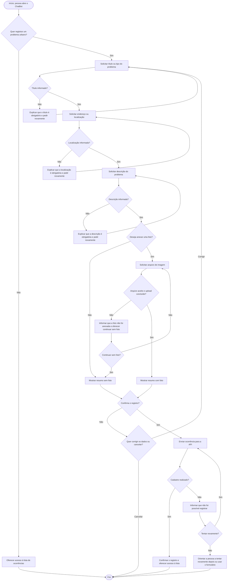

# Atividade prática — Árvore de decisão do ChatBot

## Funcionalidade escolhida

**Apoio ao cadastro de uma ocorrência urbana.** O ChatBot ficará na tela de registro e conduzirá a pessoa pelas informações que o Cidade Ativa já solicita: título, localização e descrição. A foto será opcional.

## Por que essa funcionalidade?

O cadastro é o fluxo principal do projeto: moradores informam problemas urbanos, como buracos e iluminação com defeito, para que sejam registrados. Um ChatBot pode orientar o preenchimento, verificar se os campos obrigatórios foram informados e confirmar os dados antes do envio. O registro existente envia esses dados para a API; a imagem é enviada separadamente e, se o upload não funcionar, o cadastro pode continuar sem ela.

## Árvore de decisão

## Regras e respostas esperadas

| Decisão | Comportamento do ChatBot |
|---|---|
| Pessoa não quer registrar | Encaminha para a lista de ocorrências já cadastradas. |
| Título, localização ou descrição vazios | Explica qual informação falta e pergunta novamente; não envia o cadastro incompleto. |
| Pessoa não tem foto | Continua normalmente; a foto não é obrigatória. |
| Upload da foto falha | Informa o problema e permite continuar sem foto ou tentar anexar novamente. |
| Pessoa não confirma o resumo | Permite corrigir as informações ou cancelar sem enviar. |
| Cadastro concluído | Confirma o sucesso e oferece acesso à lista de ocorrências. |
| API indisponível ou cadastro com erro | Informa que o envio falhou e oferece nova tentativa ou o formulário da página. |

## Exemplo de conversa

**ChatBot:** Olá! Posso ajudar você a registrar um problema na cidade. O que aconteceu?  
**Pessoa:** Tem um buraco na rua.  
**ChatBot:** Em qual rua ou endereço fica o problema?  
**Pessoa:** Rua das Flores, 123.  
**ChatBot:** Descreva o problema com um pouco mais de detalhe.  
**Pessoa:** O buraco é grande e está perto da faixa de pedestres.  
**ChatBot:** Você quer anexar uma foto?  
**Pessoa:** Não.  
**ChatBot:** Confira os dados: *Buraco na rua* — *Rua das Flores, 123* — *buraco grande perto da faixa de pedestres* — *sem foto*. Posso registrar?  
**Pessoa:** Sim.  
**ChatBot:** Ocorrência registrada! Obrigado por ajudar a melhorar a cidade.

## Limites da proposta

O ChatBot não promete prazo de atendimento nem informa o andamento de uma ocorrência, pois o projeto atualmente registra e lista ocorrências, mas não apresenta um fluxo de status ou acompanhamento. Seu papel nesta proposta é orientar e concluir o cadastro.
